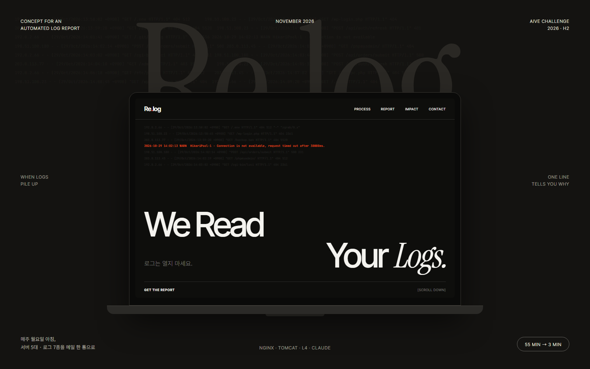

# Re.log



**We read your logs.** 서버 5대 · 로그 7종을 사람이 직접 열어 보던 주간 점검을, 월요일 아침 메일 한 통으로 바꾼 로그 리포트 자동화입니다.
Windows(Nginx + Tomcat 2종)와 Linux 이중화(WEB 2대 + WAS 2대) 운영 환경에서 매주·매월 실제로 돌고 있습니다.

- **데모 사이트:** https://silverain1004.github.io/relog/ (로그인 없음)
  - 데모(합성 로그) · 실제 운영 주간 · 실제 운영 월간(마스킹) 리포트를 실제 메일 그대로 볼 수 있습니다.
  - 사내 메일(@vntgcorp.com)을 넣으면 같은 리포트를 메일로 받아볼 수 있습니다.
- **효과(추정):** 주간 점검 약 55분 → 3분, 월간 리포트 작성 약 2시간 → 0분, 연 약 70시간 절감

## 동작

1. **수집** — Windows는 로컬 로그 폴더, Linux는 WEB1에서 SSH로 나머지 3대의 로그를 zgrep
2. **분류** — 키워드·상태코드 집계. 알려진 스캔 시그니처(FortiOS, WordPress, 정찰성)와 토큰 재발급 401은 소음으로 분리
3. **AI 요약** — 집계 수치와 마스킹한 샘플 최대 15줄만 Claude에 보내 **정상 / 주의 / 위험** 판정과 확인할 것 2~4줄을 받음
4. **발송** — HTML 메일 맨 위에 판정, 상세 리포트는 ZIP 첨부. 작업 스케줄러·cron이 매주 월요일 08:00, 매월 1일 08:00에 실행

## 폴더 구조

```
relog/
├─ app/        운영 서버에 배포되는 분석기 (이 폴더 파일만 서버에 복사)
│   ├─ win_analyzer.py      Windows 로그 분석 (PyInstaller로 exe 빌드: win_analyzer.spec)
│   ├─ linux_analyzer.py    Linux 이중화 분석 (SSH 수집, L4 편차 계산)
│   ├─ ai_summary.py        Claude Messages API 호출 (SDK 없이 urllib, Python 3.6 호환)
│   ├─ report_builder.py    HTML 상세 리포트 + 메일 본문
│   ├─ mail_sender.py       SMTP 발송, ZIP 첨부
│   └─ period_utils.py · cli_common.py · config.example.json · requirements.txt
├─ deploy/     스케줄 등록 (windows/ 작업 스케줄러, linux/ crontab) + Linux 배포 가이드
├─ demo/       합성 로그(sample_logs/)와 데모 리포트 생성기 → docs/demo/, 키비주얼 원본(showcase.html)
├─ tools/      mask_live.py (실제 리포트 마스킹 → docs/live*/), verify_reports.py (로컬 검증)
├─ mailer/     데모 사이트 "메일로 받아보기" 발송 서버 (Google Apps Script)
├─ tests/      pytest (fixtures/logs/에 테스트용 샘플 로그)
└─ docs/       GitHub Pages 사이트 (index · process · report · impact · contact)
```

## 실행

```bash
cd app
pip install -r requirements.txt
cp config.example.json config.json   # SMTP · AI · 서버 정보 입력 (git 제외)

python win_analyzer.py --auto weekly --test-email   # Windows: 본인에게만 테스트 발송
python linux_analyzer.py --auto weekly --no-email    # Linux: 리포트만 생성
```

스케줄 등록은 [deploy/](deploy/), Linux 서버 배포 절차는 [deploy/README-linux.md](deploy/README-linux.md)를 참고하세요.

## AI 요약 안전장치

- 원본 로그를 통째로 보내지 않음: 집계 수치 + '미분류' 샘플 최대 15줄만 전송
- 전송 전 IP 뒤 두 자리와 이메일 마스킹 (`10.20.x.x`, `***@***`)
- 키가 없거나 API 호출이 실패해도 리포트와 메일은 그대로 발송 (`--no-ai`로 끌 수 있음)
- API 키는 `config.json`(git 제외) 또는 환경변수 `ANTHROPIC_API_KEY`
- 비용: Claude Haiku 기준 1회 약 7원, 월 100원 미만

## 데모 · 실제 리포트 다시 만들기

```bash
python demo/generate_demo.py                                          # 저장된 AI 요약 사용
ANTHROPIC_API_KEY=sk-ant-... python demo/generate_demo.py --refresh-ai  # Claude로 새로 요약

# 실제 리포트 원본은 레포 밖 폴더에 두고 마스킹 결과만 docs/로
python tools/mask_live.py ../real-reports/weekly  --out docs/live         --deny 사람이름 서버호스트명
python tools/mask_live.py ../real-reports/monthly --out docs/live-monthly --deny 사람이름 서버호스트명

python -m pytest tests
python tools/verify_reports.py   # 샘플 로그로 Windows 리포트 생성 검증
```

마스킹은 같은 IP끼리 같은 값으로 치환하고(사설 → 10.20.x.y, 공인 → 198.18.x.y RFC 2544), 도메인·이메일·토큰·계정 경로도 치환합니다.
치환 뒤 원본 식별자가 하나라도 남아 있으면 파일을 쓰지 않고 실패하며, 원본↔치환 대응표는 원본 폴더의 `mask_map.txt`에만 남습니다.
데모 샘플 로그의 IP는 문서용 대역(RFC 5737)과 사설 대역만 사용합니다.

---

AIVE Challenge 2026 하반기 출품작
